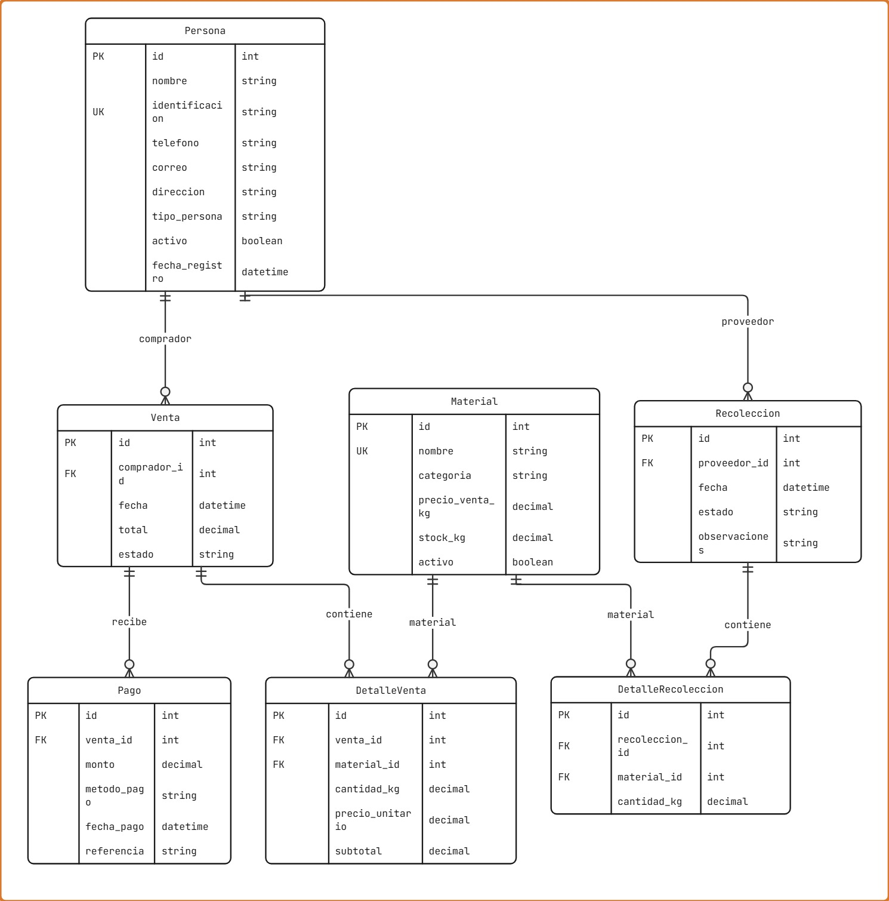

# EcoGestión
Sistema de gestión para un centro de acopio y reciclaje, desarrollado con Python, Django, Django REST Framework y MySQL.

## 1. Descripción del proyecto
EcoGestión es una API REST que permite administrar las operaciones de un centro de acopio y reciclaje, incluyendo el registro de personas, el control de materiales reciclables, las recolecciones, las ventas y los pagos.
El sistema permite controlar el inventario de materiales, registrar operaciones y gestionar el acceso a los recursos mediante autenticación por tokens y permisos de usuario.

## 2. Tecnologías utilizadas
- Python 3.13
- Django 5.2
- Django REST Framework
- MySQL
- MySQL Workbench
- TokenAuthentication
- Postman
- Git y GitHub
- Visual Studio Code

## 3. Módulos del sistema
**Personas:** Administración de proveedores y compradores.
**Inventario:** Registro de materiales reciclables, precios y cantidades disponibles.
**Recolecciones:** Registro de materiales recibidos y actualización del inventario.
**Ventas:** Registro de ventas, detalles y descuento de materiales del inventario.
**Pagos:** Registro y administración de pagos asociados a las ventas.

## 4. Diagrama entidad-relación
El siguiente diagrama representa los siete modelos del sistema EcoGestión, sus atributos, claves primarias, claves foráneas y relaciones.


Las relaciones principales son:
- Persona - Recolección: Una persona puede registrar varias recolecciones.
- Persona - Venta: Una persona puede realizar varias compras.
- Recolección - DetalleRecolección: Una recolección puede contener varios detalles.
- Material - DetalleRecolección: Un material puede aparecer en diferentes recolecciones.
- Venta - DetalleVenta: Una venta puede contener varios detalles.
- Material - DetalleVenta: Un material puede aparecer en diferentes ventas.
- Venta - Pago: Una venta puede tener varios pagos.

## 5. Requisitos previos
Para ejecutar EcoGestión es necesario contar con:
- Python instalado.
- MySQL Server instalado y funcionando.
- MySQL Workbench para administrar la base de datos.
- Visual Studio Code o cualquier editor de código.
- Acceso a una terminal.
- Credenciales de un usuario MySQL con permisos sobre la base de datos.
Postman se utiliza para realizar las pruebas de la API.

## 6. Instalación y configuración

### 6.1. Obtener el proyecto
Clonar el repositorio desde GitHub o descargar el proyecto en formato ZIP.
Abrir la carpeta principal de EcoGestión en Visual Studio Code, donde se encuentra el archivo `manage.py`.

### 6.2. Crear el entorno virtual

Desde la terminal de VS Code, ejecutar:
```powershell
py -m venv .venv
```
Activar el entorno virtual en PowerShell:
Cuando el entorno esté activado, debe aparecer `(.venv)` al inicio de la terminal.

### 6.3. Instalar las dependencias
Actualizar pip:
```powershell
python -m pip install --upgrade pip
```
La forma recomendada de instalar todas las dependencias del proyecto es:
```powershell
pip install -r requirements.txt
```
Este comando instala automáticamente las bibliotecas necesarias con las versiones indicadas en `requirements.txt`.
También es posible instalarlas manualmente mediante los siguientes comandos:

**Instalar Django:**
```powershell
pip install Django==5.2.18
```
**Instalar Django REST Framework:**
```powershell
pip install djangorestframework==3.18.3
```
**Instalar MySQL Client:**
```powershell
pip install mysqlclient==2.3.0
```
**Instalar python-dotenv:**
```powershell
pip install python-dotenv==1.2.4
```
No es necesario ejecutar los comandos individuales si ya se utilizó correctamente `pip install -r requirements.txt`.

Para verificar las instalaciones:
```powershell
py -m django --version
```
```powershell
pip list
```
### 6.4. Configurar la base de datos MySQL
Abrir MySQL Workbench y conectarse con un usuario que tenga permisos para crear bases de datos y usuarios.
Crear la base de datos:
```sql
CREATE DATABASE IF NOT EXISTS ecogestion_db;
```
Crear un usuario para el proyecto, si todavía no existe:
```sql
CREATE USER 'ecogestion_user'@'localhost'
IDENTIFIED BY 'tu_contrasena_segura';
```
Asignar permisos sobre la base de datos:
```sql
GRANT ALL PRIVILEGES ON ecogestion_db.*
TO 'ecogestion_user'@'localhost';
```
Para ejecutar las pruebas automatizadas de Django con MySQL, el usuario también necesita permisos sobre la base de datos temporal de pruebas:
```sql
GRANT ALL PRIVILEGES ON test_ecogestion_db.*
TO 'ecogestion_user'@'localhost';
```
Estos comandos son ejemplos de configuración inicial. Si la base de datos y el usuario ya existen, no es necesario crearlos nuevamente.

### 6.5. Configurar las variables de entorno
El proyecto utiliza un archivo `.env` para almacenar las credenciales de MySQL.
Copiar el archivo `.env.example` y guardar la copia con el nombre `.env`.
Configurar los datos correspondientes:
```env
DB_NAME=ecogestion_db
DB_USER=usuario_mysql
DB_PASSWORD=contrasena_mysql
DB_HOST=localhost
DB_PORT=3306
```

Se deben reemplazar los valores de ejemplo por las credenciales de MySQL configuradas en la computadora.
El archivo `.env` contiene información privada y no debe subirse a GitHub.

### 6.6. Generar y aplicar las migraciones
Para detectar cambios en los modelos:
```powershell
py manage.py makemigrations
```
Para aplicar las migraciones a MySQL:
```powershell
py manage.py migrate
```
Las migraciones incluidas en el repositorio permiten crear las tablas del sistema.

### 6.7. Crear un superusuario
Ejecutar:
```powershell
py manage.py createsuperuser
```

Completar el nombre de usuario, correo electrónico si se solicita y contraseña.
El superusuario permite ingresar al administrador de Django y configurar los grupos y permisos.

### 6.8. Configurar grupos y usuarios
Ingresar al panel de administración:
http://localhost:8000/admin/
Crear los siguientes grupos en la sección Grupos:

**Administrador:** Permisos para consultar, crear, modificar y eliminar registros.
**Operador:** Permisos para consultar, crear y modificar registros.
**Consulta:** Permisos únicamente para consultar registros.

Asignar a cada grupo los permisos correspondientes de los modelos:
- Persona
- Material
- Recoleccion
- DetalleRecoleccion
- Venta
- DetalleVenta
- Pago

Posteriormente, crear o asignar usuarios a los grupos correspondientes.
### 6.9. Ejecutar el servidor

Ejecutar:
```powershell
py manage.py runserver
```

Servidor de desarrollo:
http://localhost:8000/

Panel de administración:
http://localhost:8000/admin/

Para detener el servidor, presionar `Ctrl + C` en la terminal.

## 7. Autenticación y permisos
La API utiliza `TokenAuthentication` de Django REST Framework.

Para obtener un token, enviar una solicitud POST a:
`http://localhost:8000/api/token/`

Body JSON:
```json
{
  "username": "tu_usuario",
  "password": "tu_contrasena"
}
```
Una vez obtenido el token, agregar el siguiente encabezado en las solicitudes protegidas:
```text
Authorization: Token TU_TOKEN
```

### Matriz de permisos

| Operación | Administrador | Operador | Consulta |
|---|---|---|---|
| Consultar registros (GET) | Sí | Sí | Sí |
| Crear registros (POST) | Sí | Sí | No |
| Actualizar registros (PUT/PATCH) | Sí | Sí | No |
| Eliminar registros (DELETE) | Sí | No | No |
| Confirmar recolecciones | Sí | Sí | No |
| Cancelar recolecciones | Sí | Sí | No |
| Confirmar ventas | Sí | Sí | No |
| Anular ventas | Sí | Sí | No |
| Registrar pagos | Sí | Sí | No |

Los permisos se administran mediante los grupos y permisos nativos de Django.
Los endpoints del sistema requieren autenticación mediante token.
Un usuario sin autenticación recibe HTTP 401.
Un usuario autenticado, pero sin los permisos necesarios, recibe HTTP 403.
Las reglas de negocio deben cumplirse independientemente de los permisos del usuario.

## 8. Reglas de negocio

### 8.1. Personas
Regla 1: La identificación de cada persona debe ser única.
Regla 2: Una persona debe estar activa y tener el tipo PROVEEDOR o AMBOS para registrar recolecciones.
Regla 3: Una persona debe estar activa y tener el tipo COMPRADOR o AMBOS para registrar ventas.

### 8.2. Inventario
Regla 4: El nombre de cada material debe ser único.
Regla 5: El precio de venta por kilogramo debe ser mayor a cero.
Regla 6: El stock no puede modificarse directamente desde la API. Se actualiza mediante las confirmaciones de recolecciones y ventas.

### 8.3. Recolecciones
Regla 7: Las cantidades de los materiales recolectados deben ser mayores a cero.
Regla 8: Solamente se pueden agregar materiales activos a una recolección.
Regla 9: Solo se pueden modificar o eliminar recolecciones y detalles que estén pendientes.
Regla 10: Una recolección debe tener al menos un detalle para poder confirmarse.
Regla 11: Al confirmar una recolección, las cantidades recibidas se suman al inventario y su estado cambia a RECIBIDA.
Regla 12: Solamente se pueden cancelar recolecciones pendientes.

### 8.4. Ventas
Regla 13: Las cantidades y los precios unitarios de los detalles deben ser mayores a cero.
Regla 14: Solo se pueden modificar o eliminar ventas y detalles que estén pendientes.
Regla 15: Una venta debe contener al menos un detalle para poder confirmarse.
Regla 16: No se puede confirmar una venta si los materiales están inactivos o no existe suficiente stock.
Regla 17: Al confirmar una venta, las cantidades vendidas se descuentan del inventario y su estado cambia a CONFIRMADA.
Regla 18: El subtotal de cada detalle se calcula multiplicando la cantidad por el precio unitario. El total de la venta corresponde a la suma de sus subtotales.
Regla 19: Solamente se pueden anular ventas pendientes.

### 8.5. Pagos
Regla 20: El monto de cada pago debe ser mayor a cero.
Regla 21: Solamente se pueden registrar pagos de ventas confirmadas.
Regla 22: La suma de los pagos realizados no puede superar el total de la venta.
Regla 23: No se permite cambiar la venta asociada a un pago existente.

## 9. Endpoints de la API
URL base: `http://localhost:8000`

### 9.1. Autenticación
- POST `/api/token/`: Obtener token de acceso.

### 9.2. Personas
- GET `/api/personas/`: Listar personas.
- POST `/api/personas/`: Registrar persona.
- GET `/api/personas/<id>/`: Consultar persona.
- PUT `/api/personas/<id>/`: Actualizar persona.
- PATCH `/api/personas/<id>/`: Actualizar parcialmente.
- DELETE `/api/personas/<id>/`: Eliminar persona.

### 9.3. Inventario
- GET `/api/materiales/`: Listar materiales.
- POST `/api/materiales/`: Registrar material.
- GET `/api/materiales/<id>/`: Consultar material.
- PUT `/api/materiales/<id>/`: Actualizar material.
- PATCH `/api/materiales/<id>/`: Actualizar parcialmente.
- DELETE `/api/materiales/<id>/`: Eliminar material.

Filtros disponibles:
- `?categoria=METAL`: Filtrar por categoría.
- `?activo=true`: Filtrar materiales activos.
- `?buscar=aluminio`: Buscar materiales por nombre.
- `?orden=nombre`: Ordenar por nombre.
- `?orden=-precio_venta_kg`: Ordenar por precio descendente.
- `?page=1`: Consultar una página.

Paginación: 5 materiales por página.

### 9.4. Recolecciones
- GET `/api/recolecciones/`: Listar recolecciones.
- POST `/api/recolecciones/`: Registrar recolección.
- GET `/api/recolecciones/<id>/`: Consultar recolección.
- PUT `/api/recolecciones/<id>/`: Actualizar recolección.
- PATCH `/api/recolecciones/<id>/`: Actualizar parcialmente.
- DELETE `/api/recolecciones/<id>/`: Eliminar recolección.
- POST `/api/recolecciones/<id>/confirmar/`: Confirmar recolección y aumentar inventario.
- POST `/api/recolecciones/<id>/cancelar/`: Cancelar recolección.

Detalles de recolección:
- GET `/api/recolecciones/detalles/`: Listar detalles.
- POST `/api/recolecciones/detalles/`: Registrar detalle.
- GET `/api/recolecciones/detalles/<id>/`: Consultar detalle.
- PUT `/api/recolecciones/detalles/<id>/`: Actualizar detalle.
- PATCH `/api/recolecciones/detalles/<id>/`: Actualizar parcialmente.
- DELETE `/api/recolecciones/detalles/<id>/`: Eliminar detalle.

Filtros disponibles:
- `?estado=PENDIENTE`: Filtrar por estado.
- `?proveedor=1`: Filtrar por proveedor.
- `?page=1`: Consultar una página.
- `/api/recolecciones/detalles/?recoleccion=1`: Consultar detalles de una recolección.

Paginación: 5 recolecciones por página.

### 9.5. Ventas
- GET `/api/ventas/`: Listar ventas.
- POST `/api/ventas/`: Registrar venta.
- GET `/api/ventas/<id>/`: Consultar venta.
- PUT `/api/ventas/<id>/`: Actualizar venta.
- PATCH `/api/ventas/<id>/`: Actualizar parcialmente.
- DELETE `/api/ventas/<id>/`: Eliminar venta.
- POST `/api/ventas/<id>/confirmar/`: Confirmar venta y descontar inventario.
- POST `/api/ventas/<id>/anular/`: Anular venta.

Detalles de venta:
- GET `/api/ventas/detalles/`: Listar detalles.
- POST `/api/ventas/detalles/`: Registrar detalle.
- GET `/api/ventas/detalles/<id>/`: Consultar detalle.
- PUT `/api/ventas/detalles/<id>/`: Actualizar detalle.
- PATCH `/api/ventas/detalles/<id>/`: Actualizar parcialmente.
- DELETE `/api/ventas/detalles/<id>/`: Eliminar detalle.

Filtros disponibles:
- `?estado=PENDIENTE`: Filtrar ventas por estado.
- `?comprador=1`: Filtrar ventas por comprador.
- `/api/ventas/detalles/?venta=1`: Consultar detalles de una venta.

### 9.6. Pagos
- GET `/api/pagos/`: Listar pagos.
- POST `/api/pagos/`: Registrar pago.
- GET `/api/pagos/<id>/`: Consultar pago.
- PUT `/api/pagos/<id>/`: Actualizar pago.
- PATCH `/api/pagos/<id>/`: Actualizar parcialmente.
- DELETE `/api/pagos/<id>/`: Eliminar pago.

Filtros disponibles:
- `?venta=1`: Filtrar por venta.
- `?comprador=1`: Filtrar por comprador.
- `?metodo_pago=EFECTIVO`: Filtrar por método de pago.

## 10. Códigos de respuesta HTTP

- 200 OK: Operación realizada correctamente.
- 201 Created: Registro creado correctamente.
- 204 No Content: Registro eliminado correctamente.
- 400 Bad Request: Datos inválidos o error de validación.
- 401 Unauthorized: Usuario no autenticado.
- 403 Forbidden: Usuario sin permisos suficientes.
- 404 Not Found: Registro inexistente.
- 409 Conflict: Operación que incumple una regla de negocio.

## 11. Pruebas automatizadas
El proyecto incluye pruebas automatizadas para validar las operaciones CRUD, reglas de negocio, autenticación y permisos.
Durante el desarrollo se ejecutaron satisfactoriamente 16 pruebas automatizadas.
Para ejecutar todas las pruebas:

```powershell
py manage.py test
```
Para ejecutar las pruebas de un módulo específico:
```powershell
py manage.py test personas
```
```powershell
py manage.py test inventario
```
```powershell
py manage.py test recolecciones
```
```powershell
py manage.py test ventas
```

Las pruebas de Django utilizan una base de datos temporal y no deben modificar los registros de producción.

## 12. Pruebas con Postman
El proyecto cuenta con una colección de Postman utilizada para probar los endpoints de EcoGestión.
Se realizaron 60 solicitudes para verificar operaciones CRUD, autenticación, permisos, filtros, reglas de negocio y respuestas HTTP.
El archivo de la colección debe incluirse en el proyecto en la siguiente ubicación:

`postman/EcoGestion_API.postman_collection.json`


### Solicitudes documentadas de Postman
La colección EcoGestion API contiene 61 solicitudes para comprobar las operaciones CRUD, autenticación, permisos, filtros y reglas de negocio del sistema.
A continuación se documentan 20 solicitudes representativas con sus métodos, endpoints, descripciones y resultados esperados.

### 1. Obtener Token
Método: POST  
Endpoint: /api/token/  
Descripción: Autenticar un usuario de Django y obtener su token de acceso.  
Resultado esperado: 200 OK.

### 2. Listar Personas
Método: GET  
Endpoint: /api/personas/  
Descripción: Consultar todas las personas registradas en el sistema.  
Resultado esperado: 200 OK.

### 3. Registrar Persona
Método: POST  
Endpoint: /api/personas/  
Descripción: Registrar una persona como proveedor o comprador.  
Resultado esperado: 201 Created.

### 4. Registrar Persona Duplicada
Método: POST  
Endpoint: /api/personas/  
Descripción: Intentar registrar una persona con una identificación que ya existe.  
Resultado esperado: 400 Bad Request.

### 5. Consultar Persona Inexistente
Método: GET  
Endpoint: /api/personas/9999/  
Descripción: Intentar consultar una persona que no existe en la base de datos.  
Resultado esperado: 404 Not Found.

### 6. Acceder Sin Token
Método: GET  
Endpoint: /api/personas/  
Descripción: Intentar consultar personas sin proporcionar un token de autenticación.  
Resultado esperado: 401 Unauthorized.

### 7. Listar Materiales
Método: GET  
Endpoint: /api/materiales/  
Descripción: Consultar los materiales reciclables registrados, utilizando paginación.  
Resultado esperado: 200 OK.

### 8. Registrar Material
Método: POST  
Endpoint: /api/materiales/  
Descripción: Registrar un material reciclable con su nombre, categoría y precio por kilogramo.  
Resultado esperado: 201 Created.

### 9. Actualizar Material
Método: PUT  
Endpoint: /api/materiales/2/  
Descripción: Modificar los datos de un material, incluyendo su precio por kilogramo.  
Resultado esperado: 200 OK.

### 10. Registrar Recolección
Método: POST  
Endpoint: /api/recolecciones/  
Descripción: Crear una recolección asociada a un proveedor activo, con estado PENDIENTE.  
Resultado esperado: 201 Created.

### 11. Registrar Detalle de Recolección
Método: POST  
Endpoint: /api/recolecciones/detalles/  
Descripción: Registrar el material y los kilogramos recibidos en una recolección pendiente.  
Resultado esperado: 201 Created.

### 12. Confirmar Recolección
Método: POST  
Endpoint: /api/recolecciones/1/confirmar/  
Descripción: Confirmar una recolección, cambiar su estado a RECIBIDA y aumentar el inventario.  
Resultado esperado: 200 OK.

### 13. Verificar Stock
Método: GET  
Endpoint: /api/materiales/1/  
Descripción: Comprobar que el inventario de aluminio aumentó a 30 kg después de confirmar la recolección.  
Resultado esperado: 200 OK.

### 14. Confirmar Recolección Nuevamente
Método: POST  
Endpoint: /api/recolecciones/1/confirmar/  
Descripción: Intentar confirmar una recolección que ya se encuentra en estado RECIBIDA.  
Resultado esperado: 409 Conflict.

### 15. Eliminar Recolección Pendiente
Método: DELETE  
Endpoint: /api/recolecciones/2/  
Descripción: Eliminar una recolección que todavía se encuentra en estado PENDIENTE.  
Resultado esperado: 204 No Content.

### 16. Registrar Venta
Método: POST  
Endpoint: /api/ventas/  
Descripción: Registrar una venta asociada a un comprador activo, con estado PENDIENTE.  
Resultado esperado: 201 Created.

### 17. Registrar Detalle de Venta
Método: POST  
Endpoint: /api/ventas/detalles/  
Descripción: Registrar el material, la cantidad y el precio unitario de una venta.  
Resultado esperado: 201 Created.

### 18. Confirmar Venta
Método: POST  
Endpoint: /api/ventas/1/confirmar/  
Descripción: Confirmar una venta, cambiar su estado a CONFIRMADA y descontar los materiales del inventario.  
Resultado esperado: 200 OK.

### 19. Registrar Pago
Método: POST  
Endpoint: /api/pagos/  
Descripción: Registrar un pago asociado a una venta confirmada, verificando que no supere el total de la venta.  
Resultado esperado: 201 Created.

### 20. Crear Material Sin Permiso
Método: POST  
Endpoint: /api/materiales/  
Descripción: Intentar registrar un material utilizando un usuario del grupo Consulta, que no tiene permisos de creación.  
Resultado esperado: 403 Forbidden.

### Observaciones de las pruebas
Las solicitudes se ejecutaron utilizando Postman y el servidor local de Django.
Para las operaciones autorizadas se utilizó un superusuario de Django. Para comprobar las restricciones de acceso se utilizó un usuario perteneciente al grupo Consulta.
Los datos enviados en el Body de cada solicitud están guardados en la colección de Postman.
Los identificadores utilizados en los ejemplos corresponden a los registros creados durante las pruebas y pueden cambiar en otra instalación.
Las respuestas esperadas dependen de que se cumplan las condiciones iniciales de cada prueba, como la existencia de los registros y sus estados.
La colección completa se encuentra en:
postman/EcoGestion_API.postman_collection.json


### Importar la colección
1. Abrir Postman.
2. Seleccionar Import.
3. Buscar el archivo JSON dentro de la carpeta `postman`.
4. Importar la colección.
5. Ejecutar el servidor Django.
6. Obtener un token de autenticación mediante `/api/token/`.
7. Configurar los encabezados de autenticación.
8. Ejecutar las solicitudes correspondientes.

Para probar las operaciones administrativas se utiliza un superusuario de Django.
Para comprobar los errores 403 se utiliza un usuario del grupo Consulta, sin permisos de escritura.

## 13. Consideraciones técnicas
El sistema utiliza permisos nativos de Django, autenticación por tokens y validaciones en los serializers y vistas.

## 14. Integrantes del proyecto
- Pedro
- Stacy